<p align="center">
  
</p>

<p align="center">
  <picture>
    <source media="(prefers-color-scheme: dark)" srcset="assets/readme/hero-dark.svg">
    <source media="(prefers-color-scheme: light)" srcset="assets/readme/hero-light.svg">
    
  </picture>
</p>

<p align="center">
  <b>Screenshots and screen recordings that feel like they shipped with macOS.</b><br>
  A native menu-bar app written in Rust on AppKit, Core Animation and ScreenCaptureKit.
</p>

<p align="center">
  <a href="https://github.com/lyinet/lumora/actions/workflows/ci.yml"></a>
  <a href="LICENSE"></a>
  
  
  
</p>

<p align="center">
  <a href="#features">Features</a> ·
  <a href="#keyboard-shortcuts">Shortcuts</a> ·
  <a href="#install">Install</a> ·
  <a href="#architecture">Architecture</a> ·
  <a href="#roadmap">Roadmap</a> ·
  <a href="README.zh-CN.md">简体中文</a>
</p>

<br>

> [!NOTE]
> **Lumora is in early alpha (v0.6.1).** The whole app type-checks and passes clippy for Apple Silicon and Intel, and the platform-independent core is unit-tested. Testing on real Macs has just started (v0.6.1 fixes the first-run permission and launch issues it found), so expect rough edges. ⭐ **Star the repo to follow along**, and see [STATUS.md](STATUS.md) for exactly what is and isn't verified.

## Features

<table>
  <tr>
    <td width="50%" valign="top">
      
      <h3>Area capture, window snapping</h3>
      <p>The screen freezes while you select, so video can't change what you get. Dimmed backdrop, crisp cutout, live <code>W × H</code> pill and a pixel loupe with the hex colour under the cursor. Hover to highlight a window and click to capture it cleanly — with its shadow, even if something covers it. Edges stick to nearby windows and displays as you drag.</p>
    </td>
    <td width="50%" valign="top">
      
      <h3>Quick Access</h3>
      <p>Every capture lands in a glass card that slides in bottom-left on a spring. Hover for Copy, Save, Pin and Delete, or drag the card straight into Slack, Mail or Finder. Cards stack up to three, reflow smoothly and auto-hide after 6&nbsp;s unless you're hovering.</p>
    </td>
  </tr>
  <tr>
    <td width="50%" valign="top">
      
      <h3>Pin to screen</h3>
      <p>Float any capture above your windows as a reference. Scroll to zoom, <kbd>⌥</kbd>-scroll to fade, drag to move, double-click or <kbd>Esc</kbd> to close.</p>
    </td>
    <td width="50%" valign="top">
      
      <h3>Screen recording</h3>
      <p>Record an area or the full screen to H.264 or HEVC MP4 at 30 or 60 fps, with cursor on or off, system audio and microphone (macOS 14+), and optional click ripples. A 3-2-1 countdown ring, a red timer in the menu bar, a floating stop button, and a marching-ants border that never appears in the video.</p>
    </td>
  </tr>
</table>

**And the details that make it feel right:**

- **Retina-correct output** — PNGs at native pixel density with DPI metadata, so they display at the right size everywhere. Named like `Lumora 2026-11-15 at 04.30.12.png` and copied to the clipboard as PNG (plus the file, for pasting into Finder or chat apps).
- **Keyboard precision** — move, aspect-lock and nudge a selection to the point without touching the mouse (see below).
- **Motion with physics** — every appear, snap, nudge and reflow is a damped spring that keeps its velocity when interrupted. Direct manipulation is never animated, so the selection never lags your pointer.
- **Shutter, then fly** — a flash over the region, then the capture shrinks onto its card while the card slides in.
- **Beautify** — frame a capture on a gradient, colour or image background with padding, rounded corners, a soft shadow, an optional macOS window frame and fixed aspect ratios (16:9, 1:1, …), edited live from the ✨ panel in the annotation editor.
- **Editable `.lumora` documents** — every saved screenshot keeps a `.lumora` file beside its PNG with the original capture, annotations and beautify style; double-click it in Finder (or use Open…) and every arrow, label and crop is still editable.
- **AI Writing (optional, off by default)** — press ✨ / <kbd>⌘</kbd><kbd>J</kbd> in the editor to write a caption, a step guide, alt text, or to polish, translate (English / 简体中文) or summarize, streamed into a sheet you can insert as a text annotation. Bring your own provider: OpenAI, DeepSeek, Qwen, Kimi (Moonshot), a local Ollama or any OpenAI-compatible endpoint. Your API key stays in the macOS Keychain; by default only the on-device recognised text and your annotation text are sent — never text you cropped away or covered with a redaction, and the screenshot itself only if you opt in. Text is recognised once per capture and reused by Smart Redaction and every AI task.
- **Smart Redaction** — one click (or <kbd>⌘</kbd><kbd>⇧</kbd><kbd>R</kbd>) in the editor pixelates or blurs emails, phone numbers, Chinese ID and bank card numbers (checksum-verified), API keys and tokens, IP addresses, secrets in links and faces — detected on your Mac with Vision, added as one undoable group. Choose categories in Settings → Capture, optionally redact every new screenshot before it's copied or saved, or add an AI check that sends recognised text only, never the image.
- **OCR actions** — after Capture Text (<kbd>⌥</kbd><kbd>⇧</kbd><kbd>2</kbd>) copies the text, a small floating panel offers Copy, Summarize, Translate (English / 简体中文), As Table, As Code and Checklist, streamed into a result sheet with Copy, Stop and Retry. Summarize and Translate use AI Writing; the rest work without it.
- **Screenshot → table / code** — rebuild a table from a screenshot on your Mac (rows and columns recovered from the text positions) and copy it as Markdown or CSV, or turn a screenshot of code back into code with its indentation restored. With AI Writing on, AI refines the on-device result; the editor's AI menu has Extract table and Extract code too.
- **Click ripples** — while recording, every click draws a springy ring (blue for left, orange for right) that appears in the video, while the border, stop button and toasts stay out of it. Toggle it in Settings → Recording. Each click is also logged with its time, position and app to a `<movie>.events.json` file next to the video, ready for step-by-step tutorials.
- **Keystroke HUD** — optional (Settings → Recording, off by default): shortcuts such as <kbd>⇧</kbd><kbd>⌘</kbd><kbd>4</kbd> and keys such as ↩ ⌫ ← appear in a small pill in the video (bottom center, bottom left / right or top center), repeats merge into `×N`, and it fades after about a second. Plain typing is never shown, nothing is shown while a password field has secure input on, and no keystroke is ever saved. Needs Input Monitoring; without it the recording simply goes ahead without keystrokes.
- **Recording → tutorial** — click **Make Tutorial** on a recording's Quick Access card (or **Make Tutorial from Recording…** in the menu bar) and Lumora turns the clicks into a step-by-step guide: a frame just after each click with a highlight ring, cropped around the pointer, titled from the text next to it (read on your Mac). With AI on, the steps are written by your provider from text only — app, window title and nearby words, never the frames. Edit or delete steps, then export Markdown, a single self-contained HTML page (light and dark), or copy Markdown.
- **Trim and GIF** — click **Trim / GIF…** (scissors) on a recording's Quick Access card or in the capture history. Drag Start and End (the preview follows), then **Save Trimmed** — a saved recording gets a new `<name> (trimmed)` copy next to it, a temporary one is trimmed in place; the click log and subtitles are shifted to match (tutorial steps are not kept). **Export GIF…** uses the same range at 480 / 640 / 800 px or the original width and 10 / 15 / 20 fps, shows a size estimate, loops forever and lands next to the recording. Both run in the background with a progress bar and Cancel; trimming doesn't re-encode the video.
- **Subtitles, summary and chapters** — click **Subtitles** on a recording's Quick Access card (or **Transcribe Recording…** in the menu bar). Speech is recognised on your Mac with Apple Speech by default (strictly on-device unless you allow Apple's servers), or by your AI provider's Whisper-compatible endpoint (audio up to 25 MB). Choose the spoken language (Chinese, English or the app's language) and the audio source (microphone, system audio or both) in Settings → Recording. Lumora then writes a short summary and chapters — by AI when it's on (text only), otherwise locally from pauses and clicks. Edit the lines (<kbd>Esc</kbd> finishes an edit, a second <kbd>Esc</kbd> closes the window; long recordings open instantly), then export SRT or WebVTT, or copy the chapters (YouTube-style) and the summary. **Burn In Subtitles…** draws them into a `<name> (subtitled)` copy of the video (white text, Small / Medium / Large, bottom or top, optional rounded background box — remembered for next time) in the background with a progress bar and Cancel, and shows it in Quick Access. Everything is kept in `<movie>.transcript.json` and reopens with your edits.
- **Scrolling capture** — press <kbd>⌥</kbd><kbd>⇧</kbd><kbd>S</kbd> (or **Scrolling Capture** in the menu bar), drag over the part of a window that scrolls, then scroll slowly. Lumora screenshots the area a few times a second and stitches the frames that moved into one tall image; sticky headers and footers appear once. A small panel shows the frame count — **Done** (or <kbd>↩</kbd>, or the shortcut again) finishes, **Cancel** (or <kbd>Esc</kbd>) discards. Nothing ends the session before you scroll: clicking into the window to focus it, hover effects, a blinking caret or a frame that didn't move are skipped. Scrolling back up is ignored; once you've scrolled, losing track for about two seconds (scrolling too fast to line up) or reaching 20,000 px stops with a note and keeps what was stitched. Lumora never scrolls for you, so no Accessibility permission is needed. The result is a normal capture: Quick Access, copy / save, history and the editor.
- **Capture history** — press <kbd>⌥</kbd><kbd>⇧</kbd><kbd>H</kbd> (or **Capture History…** in the menu bar) for a grid of every screenshot, recording and `.lumora` document in your captures folder. Filter by type, search file names *and the text in your screenshots* (recognised on your Mac while the window is open), then reopen in the editor (the `.lumora` when there is one, so annotations stay editable), copy, show in Finder or move to the Trash. Only Lumora's own files are listed (by `.lumora` / sidecar or your file-name template), thumbnails are made in the background and cached. An optional retention setting (Settings → General: keep everything, 30 or 90 days) only *offers* to move older captures to the Trash, with confirmation — nothing is ever deleted outright.
- **Microphone recording on macOS 14+** — record your voice with the screen on macOS 14 as well as 15, from the system default or a microphone you pick in Settings → Recording. Lumora asks for microphone access the first time.

## Keyboard shortcuts

Option-Shift avoids clashing with macOS's own <kbd>⇧</kbd><kbd>⌘</kbd><kbd>3</kbd>/<kbd>4</kbd>/<kbd>5</kbd>. Rebind everything in **Settings → Shortcuts**.

| Global | Shortcut |
|---|---|
| Capture area | <kbd>⌥</kbd> <kbd>⇧</kbd> <kbd>4</kbd> |
| Capture fullscreen | <kbd>⌥</kbd> <kbd>⇧</kbd> <kbd>3</kbd> |
| Capture window | <kbd>⌥</kbd> <kbd>⇧</kbd> <kbd>5</kbd> |
| Record screen (start / stop) | <kbd>⌥</kbd> <kbd>⇧</kbd> <kbd>R</kbd> |
| Open captures folder | <kbd>⌥</kbd> <kbd>⇧</kbd> <kbd>O</kbd> |
| Capture history | <kbd>⌥</kbd> <kbd>⇧</kbd> <kbd>H</kbd> |
| Scrolling capture (start / done) | <kbd>⌥</kbd> <kbd>⇧</kbd> <kbd>S</kbd> |

| In the capture overlay | Key |
|---|---|
| Move the selection while dragging | <kbd>Space</kbd> |
| Lock the aspect ratio | <kbd>⇧</kbd> |
| Nudge 1 pt · 10 pt · resize | <kbd>←</kbd> <kbd>↑</kbd> <kbd>→</kbd> <kbd>↓</kbd> · with <kbd>⇧</kbd> · with <kbd>⌥</kbd> |
| Temporarily disable edge snapping | hold <kbd>⌥</kbd> while dragging |
| Copy the colour under the loupe (hex) | <kbd>C</kbd> |
| Confirm (or double-click) | <kbd>Enter</kbd> |
| Cancel | <kbd>Esc</kbd> |

## Why Lumora

<table>
  <tr>
    <td width="50%" valign="top"><b>Native to the core</b><br>Rust over AppKit, Core Animation and ScreenCaptureKit through typed <code>objc2</code> bindings. No web view, no Electron, no runtime to ship.</td>
    <td width="50%" valign="top"><b>Closed-form spring physics</b><br>Motion comes from an analytic damped-oscillator solver in <code>lumora-core</code>, shared by Core Animation layers and window animations, with unit tests pinning settle times and overshoot.</td>
  </tr>
  <tr>
    <td width="50%" valign="top"><b>Tiny native binary</b><br>A menu-bar app that compiles to a single native executable, built with thin LTO and stripped symbols in release.</td>
    <td width="50%" valign="top"><b>Open source, MIT</b><br>Readable, documented code with a strict crate layering, <code>SAFETY:</code> comments on every unsafe block and design tokens mirrored in <a href="DESIGN.md">DESIGN.md</a>.</td>
  </tr>
</table>

## Install

**Homebrew cask — coming soon.** A signed and notarized build will follow hardware bring-up ([roadmap](#roadmap)). Until then, download `Lumora-<version>.dmg` from the latest pre-release on the Releases page (ad-hoc signed: drag Lumora to Applications, then see [Troubleshooting](#troubleshooting) for the first launch) or build from source.

### Build from source

Requirements: macOS 14+, Xcode command-line tools, Rust stable 1.80+.

```sh
git clone https://github.com/lyinet/lumora.git
cd lumora

# Run a debug build from the terminal
# (permission prompts will name your terminal app)
cargo run -p lumora

# Universal (arm64 + x86_64) app bundle + DMG, ad-hoc signed
brew install create-dmg   # optional; falls back to hdiutil
scripts/bundle.sh
open dist/Lumora.app

# Signed + notarized release
SIGN_IDENTITY="Developer ID Application: Your Name (TEAMID)" \
NOTARY_PROFILE=lumora-notary scripts/bundle.sh
```

> [!TIP]
> Screen Recording permission is tied to the app's code signature. Ad-hoc builds get a new identity each time, so macOS asks again after every rebuild — use a stable signing identity for day-to-day development.

### Permissions

Lumora asks for each permission only when a feature first needs it:

| Permission | Needed for |
|---|---|
| **Screen Recording** | Every screenshot and recording (required) |
| **Microphone** | Recording your voice, only when the microphone is turned on in Settings → Recording |
| **Speech Recognition** | On-device subtitles with Apple Speech, only when you transcribe a recording |
| **Input Monitoring** | The keystroke HUD while recording, only when it is turned on in Settings → Recording (listen-only; nothing is stored) |
| **Keychain** | Storing and reading your AI provider's API key (`app.lumora.ai`), only if you use AI features |

No Accessibility access is needed, and Input Monitoring only for the optional keystroke HUD. Network requests go only to the AI provider you configure, and only when you use an AI feature or cloud transcription.

### Troubleshooting

Lumora is a **menu-bar app**: it has no Dock icon and no main window. When it starts with Screen Recording already allowed, it shows a short “Lumora is running in the menu bar” notice and then lives behind its icon in the menu bar. Opening Lumora again from Finder or Spotlight opens Settings.

**Lumora isn’t listed under Screen & System Audio Recording, or Grant Access does nothing**

1. Move `Lumora.app` to `/Applications` (drag it there from the disk image) and open it from there. A copy opened straight from the disk image or from Downloads runs from a temporary location (App Translocation), and permissions don’t stick to it. Lumora offers to move itself when it notices this.
2. If macOS still won’t show it, remove the download quarantine flag and open it again:
   ```sh
   /usr/bin/xattr -dr com.apple.quarantine /Applications/Lumora.app
   ```
3. Reset Lumora’s Screen Recording entry, open Lumora, click **Grant Access**, allow it, then relaunch:
   ```sh
   tccutil reset ScreenCapture com.lumora.app
   ```

**Capturing does nothing, or macOS keeps refusing although Lumora is switched on.** Pre-release builds are ad-hoc signed, so macOS treats **every update as a new app** and the old grant no longer applies. After installing an update, remove Lumora from Screen & System Audio Recording with “–” (or run the `tccutil` command above), allow it again, and relaunch. Lumora now explains this itself when macOS refuses a capture.

**Grant the permission with Lumora launched from Finder, Spotlight or Launchpad — not from a terminal.** When Lumora is started from a terminal (running the binary, and in some setups even `open`), macOS treats the terminal as the responsible app: the prompt then asks to let *your terminal* (Terminal, iTerm, XTerminal…) record the screen, and the grant goes to the terminal instead of Lumora. Quit Lumora, open it by double-clicking it in Applications (or via Spotlight / Launchpad), then click **Grant Access**.

**I can’t see the menu-bar icon.** On macOS 26 check System Settings → Menu Bar and allow Lumora; on a crowded menu bar (especially next to the notch) icons can be hidden. The shortcuts (<kbd>⌥</kbd><kbd>⇧</kbd><kbd>4</kbd> and friends) still work.

**Logs.** Lumora writes a log to `~/Library/Logs/Lumora/lumora.log` (also readable in Console.app); a crash leaves its panic message and backtrace there. For more detail, start it with debug logging:
```sh
LUMORA_DEBUG=1 /Applications/Lumora.app/Contents/MacOS/lumora   # or LUMORA_LOG=debug / RUST_LOG=debug
```
Caveat: a copy started from a terminal uses the **terminal’s** Screen Recording permission (see above), so use this for reading logs, not for granting or testing the permission; the log file is written either way, so for permission problems launch normally and read `~/Library/Logs/Lumora/lumora.log` afterwards. Please attach the log when you report a bug.

<details>
<summary><b>Developing on Linux or in CI</b></summary>

<br>

The pure-logic crates build and test anywhere:

```sh
cargo test -p lumora-core -p lumora-ui -p lumora-ai   # geometry, springs, selection, settings, hotkeys, tokens
```

With the Apple targets installed you can type-check the whole app from any host:

```sh
rustup target add aarch64-apple-darwin x86_64-apple-darwin
cargo check --workspace --target aarch64-apple-darwin
cargo clippy --workspace --all-targets --target x86_64-apple-darwin -- -D warnings
```

</details>

<details>
<summary><b>Settings & logs</b></summary>

<br>

Settings are stored as TOML at `~/Library/Application Support/Lumora/settings.toml`. Missing keys fall back to defaults, unknown keys are ignored, and a corrupt file is moved aside to `settings.toml.bak`. A cleared shortcut is saved as `""` and stays cleared.

The capture history index (file list, dimensions and the text recognised in your screenshots, for search) is `history.json` next to it, with thumbnails in `Thumbnails/`. Both are caches: delete them any time and the next scan rebuilds them; nothing leaves your Mac. Logs go to stderr and `~/Library/Logs/Lumora/lumora.log`; set `LUMORA_DEBUG=1` (or `LUMORA_LOG=debug` / `RUST_LOG=debug`) for more — see [Troubleshooting](#troubleshooting).

</details>

## Architecture

<p align="center">
  
</p>

A Cargo workspace of five crates with a strict dependency direction. Logic that doesn't need the OS lives in the bottom crate and is tested on every host; every crate above it is a thin, typed layer over Apple frameworks.

| Crate | What it owns |
|---|---|
| [`apps/lumora`](apps/lumora) | The binary: `NSApplication`, status item, hidden main menu, Carbon hotkeys, app state and the capture / record / OCR / redaction / tutorial / transcription flows |
| [`lumora-ui`](crates/lumora-ui) | AppKit + Core Animation: overlay, Quick Access, pins, shutter, countdown, recording HUD, settings, onboarding, annotation editor + beautify panel + AI sheet, Capture Text actions panel, click-ripple overlay, tutorial, transcript and capture-history windows |
| [`lumora-ai`](crates/lumora-ai) | OpenAI-compatible streaming chat and `/audio/transcriptions` clients, Keychain key storage |
| [`lumora-capture`](crates/lumora-capture) | ScreenCaptureKit, ImageIO, AVFoundation (incl. `AVCaptureSession` mic on macOS 14), pasteboard, beautify renderer, Vision OCR + face detection, tutorial frame rendering, Apple Speech transcription |
| [`lumora-core`](crates/lumora-core) | Pure Rust: geometry, springs, selection state machine, snapping, settings, file names, hotkey parsing, layout, recording state machine, beautify model, `.lumora` document format, AI settings / prompts / stream parsing, redaction detectors, table / code extraction, click log, tutorial model + export, transcript (SRT / VTT, chapters, summary, burn-in layout), temp-folder cleanup, capture-history index |

Deep dives: [ARCHITECTURE.md](ARCHITECTURE.md) (threading, data flow, coordinate spaces) · [DESIGN.md](DESIGN.md) (colour, shape, type and motion tokens).

## Roadmap

Everything below is written, type-checked and unit-tested, but **not yet run on real hardware**.

- [x] **v0.1 — capture & record:** area / window / fullscreen capture on frozen frames, Quick Access, pins, screen recording, settings, onboarding
- [x] **v0.2 — annotate:** annotation editor, OCR (Capture Text), toast HUD, zh-Hans localisation, app icon, window-only mode, multi-display areas
- [x] **v0.3 — beautify:** backgrounds, padding, shadow, window frame, aspect ratios; editable `.lumora` documents
- [x] **v0.4 — AI Writing:** captions, step guides, alt text, polish, translate, summarize with your own provider
- [x] **v0.5 — AI combo:** Smart Redaction (on-device detection, one-click pixelate / blur, optional AI check); OCR actions panel and screenshot → table / code, local-first; click ripples, click-event log and microphone on macOS 14; recording → step-by-step tutorial; subtitles, summary and chapters (on-device or cloud, SRT / VTT)
- [x] **v0.5.1 — polish:** PNG clipboard, one OCR pass per capture (AI Writing skips cropped / redacted text), no Keychain prompts on the main thread, sturdier transcript window, clearer subtitle errors, scrollable Settings tabs

- [x] **v0.6 — history & recording extras:** capture history window (<kbd>⌥</kbd><kbd>⇧</kbd><kbd>H</kbd>), keystroke HUD, trim + GIF export, burn-in subtitles, scrolling capture (<kbd>⌥</kbd><kbd>⇧</kbd><kbd>S</kbd>)

**v0.7 — next**

- [ ] Real-Mac bring-up on Apple Silicon + Intel (macOS 14 & 15) and bug fixes
- [ ] Developer ID signing + notarization in CI
- [ ] Keyboard-layout-aware keystroke labels, scroll-wheel driven scrolling capture, live preview for burned-in subtitles

**Later**

- [ ] Sparkle updates, Homebrew cask
- [ ] Editor polish, recording pause/resume and webcam bubble, cloud links, Shortcuts automation
- [ ] Mac App Store variant, more localisations (ja, zh-Hant, de, fr, es)

Full details in [ROADMAP.md](ROADMAP.md) and [CHANGELOG.md](CHANGELOG.md).

## Contributing

Contributions are very welcome — and right now the most valuable one is simply **running Lumora on a Mac**. If you try it, please open an issue with your chip, macOS version and what worked or broke.

- **Before a larger change**, open an issue to talk it through.
- **Keep CI green:** `cargo fmt --all`, `cargo clippy --workspace --all-targets -- -D warnings` (on a Mac, or with `--target aarch64-apple-darwin` elsewhere), and `cargo test` (the core crates run on any host).
- **Design tokens live in two places** — `crates/lumora-ui/src/tokens.rs` and [DESIGN.md](DESIGN.md). Change both together.
- **Unsafe code** stays confined to FFI calls, each with a `SAFETY:` comment.

## License

[MIT](LICENSE) © Lumora contributors

<br>

<p align="center">
  
  <br>
  <sub>Built with Rust, AppKit and a lot of springs.</sub>
</p>
