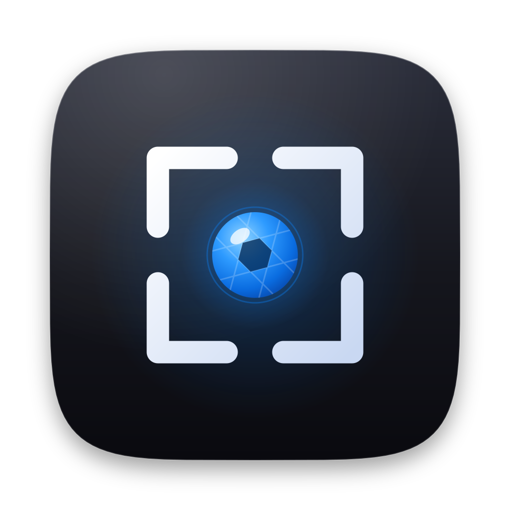
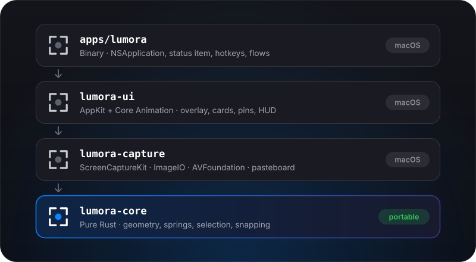

<p align="center">
  
</p>

<p align="center">
  <picture>
    <source media="(prefers-color-scheme: dark)" srcset="assets/readme/hero-dark.svg">
    <source media="(prefers-color-scheme: light)" srcset="assets/readme/hero-light.svg">
    
  </picture>
</p>

<p align="center">
  <b>Screenshots and screen recordings that feel like they shipped with macOS.</b><br>
  A native menu-bar app written in Rust on AppKit, Core Animation and ScreenCaptureKit.
</p>

<p align="center">
  <a href="https://github.com/lyinet/lumora/actions/workflows/ci.yml"></a>
  <a href="LICENSE"></a>
  
  
  
</p>

<p align="center">
  <a href="#features">Features</a> ·
  <a href="#keyboard-shortcuts">Shortcuts</a> ·
  <a href="#install">Install</a> ·
  <a href="#architecture">Architecture</a> ·
  <a href="#roadmap">Roadmap</a> ·
  <a href="README.zh-CN.md">简体中文</a>
</p>

<br>

> [!NOTE]
> **Lumora is in early alpha (v0.4).** The whole app type-checks and passes clippy for Apple Silicon and Intel, and the platform-independent core is unit-tested — but it **has not been run on real hardware yet**, so expect rough edges. Hardware bring-up is the next milestone. ⭐ **Star the repo to follow along**, and see [STATUS.md](STATUS.md) for exactly what is and isn't verified.

## Features

<table>
  <tr>
    <td width="50%" valign="top">
      
      <h3>Area capture, window snapping</h3>
      <p>The screen freezes while you select, so video can't change what you get. Dimmed backdrop, crisp cutout, live <code>W × H</code> pill and a pixel loupe with the hex colour under the cursor. Hover to highlight a window and click to capture it cleanly — with its shadow, even if something covers it. Edges stick to nearby windows and displays as you drag.</p>
    </td>
    <td width="50%" valign="top">
      
      <h3>Quick Access</h3>
      <p>Every capture lands in a glass card that slides in bottom-left on a spring. Hover for Copy, Save, Pin and Delete, or drag the card straight into Slack, Mail or Finder. Cards stack up to three, reflow smoothly and auto-hide after 6&nbsp;s unless you're hovering.</p>
    </td>
  </tr>
  <tr>
    <td width="50%" valign="top">
      
      <h3>Pin to screen</h3>
      <p>Float any capture above your windows as a reference. Scroll to zoom, <kbd>⌥</kbd>-scroll to fade, drag to move, double-click or <kbd>Esc</kbd> to close.</p>
    </td>
    <td width="50%" valign="top">
      
      <h3>Screen recording</h3>
      <p>Record an area or the full screen to H.264 or HEVC MP4 at 30 or 60 fps, with cursor on or off, system audio and microphone (macOS 15+). A 3-2-1 countdown ring, a red timer in the menu bar, a floating stop button, and a marching-ants border that never appears in the video.</p>
    </td>
  </tr>
</table>

**And the details that make it feel right:**

- **Retina-correct output** — PNGs at native pixel density with DPI metadata, so they display at the right size everywhere. Named like `Lumora 2026-11-15 at 04.30.12.png` and copied to the clipboard.
- **Keyboard precision** — move, aspect-lock and nudge a selection to the point without touching the mouse (see below).
- **Motion with physics** — every appear, snap, nudge and reflow is a damped spring that keeps its velocity when interrupted. Direct manipulation is never animated, so the selection never lags your pointer.
- **Shutter, then fly** — a flash over the region, then the capture shrinks onto its card while the card slides in.
- **Beautify** — frame a capture on a gradient, colour or image background with padding, rounded corners, a soft shadow, an optional macOS window frame and fixed aspect ratios (16:9, 1:1, …), edited live from the ✨ panel in the annotation editor.
- **Editable `.lumora` documents** — every saved screenshot keeps a `.lumora` file beside its PNG with the original capture, annotations and beautify style; double-click it in Finder (or use Open…) and every arrow, label and crop is still editable.
- **AI Writing (optional, off by default)** — press ✨ / <kbd>⌘</kbd><kbd>J</kbd> in the editor to write a caption, a step guide, alt text, or to polish, translate (English / 简体中文) or summarize, streamed into a sheet you can insert as a text annotation. Bring your own provider: OpenAI, DeepSeek, Qwen, Kimi (Moonshot), a local Ollama or any OpenAI-compatible endpoint. Your API key stays in the macOS Keychain; by default only the on-device recognised text and your annotation text are sent — the screenshot itself only if you opt in.
- **Smart Redaction** — one click (or <kbd>⌘</kbd><kbd>⇧</kbd><kbd>R</kbd>) in the editor pixelates or blurs emails, phone numbers, Chinese ID and bank card numbers (checksum-verified), API keys and tokens, IP addresses, secrets in links and faces — detected on your Mac with Vision, added as one undoable group. Choose categories in Settings → Capture, optionally redact every new screenshot before it's copied or saved, or add an AI check that sends recognised text only, never the image.

## Keyboard shortcuts

Option-Shift avoids clashing with macOS's own <kbd>⇧</kbd><kbd>⌘</kbd><kbd>3</kbd>/<kbd>4</kbd>/<kbd>5</kbd>. Rebind everything in **Settings → Shortcuts**.

| Global | Shortcut |
|---|---|
| Capture area | <kbd>⌥</kbd> <kbd>⇧</kbd> <kbd>4</kbd> |
| Capture fullscreen | <kbd>⌥</kbd> <kbd>⇧</kbd> <kbd>3</kbd> |
| Capture window | <kbd>⌥</kbd> <kbd>⇧</kbd> <kbd>5</kbd> |
| Record screen (start / stop) | <kbd>⌥</kbd> <kbd>⇧</kbd> <kbd>R</kbd> |
| Open captures folder | <kbd>⌥</kbd> <kbd>⇧</kbd> <kbd>O</kbd> |

| In the capture overlay | Key |
|---|---|
| Move the selection while dragging | <kbd>Space</kbd> |
| Lock the aspect ratio | <kbd>⇧</kbd> |
| Nudge 1 pt · 10 pt · resize | <kbd>←</kbd> <kbd>↑</kbd> <kbd>→</kbd> <kbd>↓</kbd> · with <kbd>⇧</kbd> · with <kbd>⌥</kbd> |
| Temporarily disable edge snapping | hold <kbd>⌥</kbd> while dragging |
| Copy the colour under the loupe (hex) | <kbd>C</kbd> |
| Confirm (or double-click) | <kbd>Enter</kbd> |
| Cancel | <kbd>Esc</kbd> |

## Why Lumora

<table>
  <tr>
    <td width="50%" valign="top"><b>Native to the core</b><br>Rust over AppKit, Core Animation and ScreenCaptureKit through typed <code>objc2</code> bindings. No web view, no Electron, no runtime to ship.</td>
    <td width="50%" valign="top"><b>Closed-form spring physics</b><br>Motion comes from an analytic damped-oscillator solver in <code>lumora-core</code>, shared by Core Animation layers and window animations, with unit tests pinning settle times and overshoot.</td>
  </tr>
  <tr>
    <td width="50%" valign="top"><b>Tiny native binary</b><br>A menu-bar app that compiles to a single native executable, built with thin LTO and stripped symbols in release.</td>
    <td width="50%" valign="top"><b>Open source, MIT</b><br>Readable, documented code with a strict crate layering, <code>SAFETY:</code> comments on every unsafe block and design tokens mirrored in <a href="DESIGN.md">DESIGN.md</a>.</td>
  </tr>
</table>

## Install

**Homebrew cask — coming soon.** A signed and notarized build will follow hardware bring-up ([roadmap](#roadmap)). Until then, build from source.

### Build from source

Requirements: macOS 14+, Xcode command-line tools, Rust stable 1.80+.

```sh
git clone https://github.com/lyinet/lumora.git
cd lumora

# Run a debug build from the terminal
# (permission prompts will name your terminal app)
cargo run -p lumora

# Universal (arm64 + x86_64) app bundle + DMG, ad-hoc signed
brew install create-dmg   # optional; falls back to hdiutil
scripts/bundle.sh
open dist/Lumora.app

# Signed + notarized release
SIGN_IDENTITY="Developer ID Application: Your Name (TEAMID)" \
NOTARY_PROFILE=lumora-notary scripts/bundle.sh
```

> [!TIP]
> Screen Recording permission is tied to the app's code signature. Ad-hoc builds get a new identity each time, so macOS asks again after every rebuild — use a stable signing identity for day-to-day development.

<details>
<summary><b>Developing on Linux or in CI</b></summary>

<br>

The pure-logic crates build and test anywhere:

```sh
cargo test -p lumora-core -p lumora-ui -p lumora-ai   # geometry, springs, selection, settings, hotkeys, tokens
```

With the Apple targets installed you can type-check the whole app from any host:

```sh
rustup target add aarch64-apple-darwin x86_64-apple-darwin
cargo check --workspace --target aarch64-apple-darwin
cargo clippy --workspace --all-targets --target x86_64-apple-darwin -- -D warnings
```

</details>

<details>
<summary><b>Settings & logs</b></summary>

<br>

Settings are stored as TOML at `~/Library/Application Support/Lumora/settings.toml`. Missing keys fall back to defaults, unknown keys are ignored, and a corrupt file is moved aside to `settings.toml.bak`. Logs go to stderr; set `LUMORA_LOG=debug` for more.

</details>

## Architecture

<p align="center">
  
</p>

A Cargo workspace of five crates with a strict dependency direction. Logic that doesn't need the OS lives in the bottom crate and is tested on every host; every crate above it is a thin, typed layer over Apple frameworks.

| Crate | What it owns |
|---|---|
| [`apps/lumora`](apps/lumora) | The binary: `NSApplication`, status item, Carbon hotkeys, app state and capture/record flows |
| [`lumora-ui`](crates/lumora-ui) | AppKit + Core Animation: overlay, Quick Access, pins, shutter, countdown, recording HUD, settings, onboarding, annotation editor + beautify panel + AI sheet |
| [`lumora-ai`](crates/lumora-ai) | OpenAI-compatible streaming client and Keychain key storage for AI Writing |
| [`lumora-capture`](crates/lumora-capture) | ScreenCaptureKit, ImageIO, AVFoundation, pasteboard, beautify renderer |
| [`lumora-core`](crates/lumora-core) | Pure Rust: geometry, springs, selection state machine, snapping, settings, file names, hotkey parsing, layout, recording state machine, beautify model, `.lumora` document format, AI settings / prompts / stream parsing |

Deep dives: [ARCHITECTURE.md](ARCHITECTURE.md) (threading, data flow, coordinate spaces) · [DESIGN.md](DESIGN.md) (colour, shape, type and motion tokens).

## Roadmap

Everything below is written, type-checked and unit-tested, but **not yet run on real hardware**.

- [x] **v0.1 — capture & record:** area / window / fullscreen capture on frozen frames, Quick Access, pins, screen recording, settings, onboarding
- [x] **v0.2 — annotate:** annotation editor, OCR (Capture Text), toast HUD, zh-Hans localisation, app icon, window-only mode, multi-display areas
- [x] **v0.3 — beautify:** backgrounds, padding, shadow, window frame, aspect ratios; editable `.lumora` documents
- [x] **v0.4 — AI Writing:** captions, step guides, alt text, polish, translate, summarize with your own provider

**v0.5 — next**

- [x] Smart Redaction: on-device detection of personal and secret data, one-click pixelate / blur, optional AI check
- [ ] Real-Mac bring-up on Apple Silicon + Intel (macOS 14 & 15) and bug fixes
- [ ] Capture history window (<kbd>⌥</kbd><kbd>⇧</kbd><kbd>H</kbd>)
- [ ] Recording extras: click ripples, keystroke HUD, microphone on macOS 14, GIF export + trim
- [ ] Scrolling capture
- [ ] AI actions on the OCR toast

**Later**

- [ ] Developer ID signing + notarization, Sparkle updates, Homebrew cask
- [ ] Editor polish, recording pause/resume and webcam bubble, cloud links, Shortcuts automation
- [ ] Mac App Store variant, more localisations (ja, zh-Hant, de, fr, es)

Full details in [ROADMAP.md](ROADMAP.md) and [CHANGELOG.md](CHANGELOG.md).

## Contributing

Contributions are very welcome — and right now the most valuable one is simply **running Lumora on a Mac**. If you try it, please open an issue with your chip, macOS version and what worked or broke.

- **Before a larger change**, open an issue to talk it through.
- **Keep CI green:** `cargo fmt --all`, `cargo clippy --workspace --all-targets -- -D warnings` (on a Mac, or with `--target aarch64-apple-darwin` elsewhere), and `cargo test` (the core crates run on any host).
- **Design tokens live in two places** — `crates/lumora-ui/src/tokens.rs` and [DESIGN.md](DESIGN.md). Change both together.
- **Unsafe code** stays confined to FFI calls, each with a `SAFETY:` comment.

## License

[MIT](LICENSE) © Lumora contributors

<br>

<p align="center">
  
  <br>
  <sub>Built with Rust, AppKit and a lot of springs.</sub>
</p>
