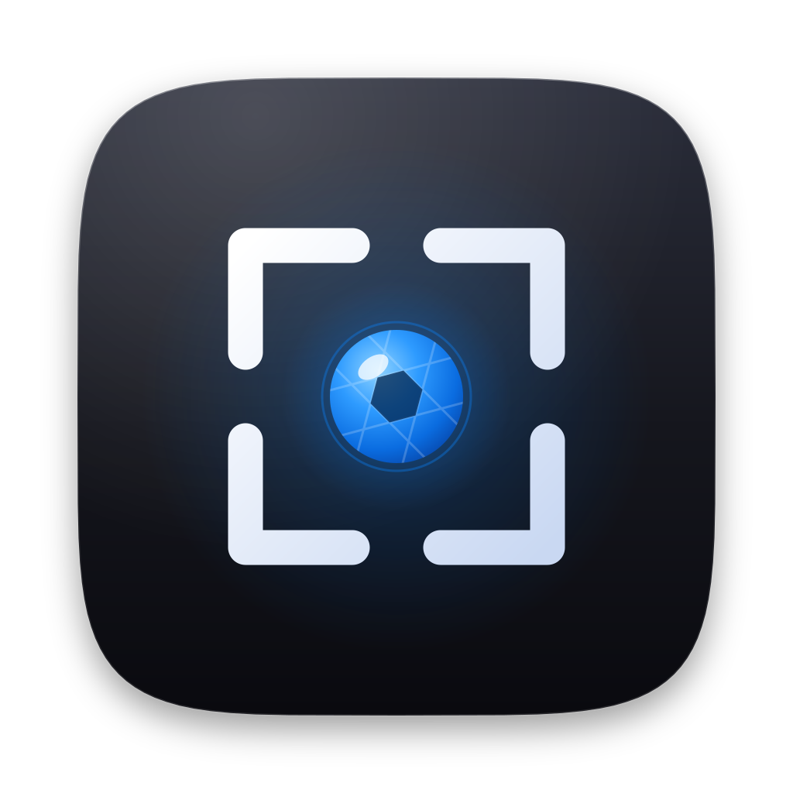
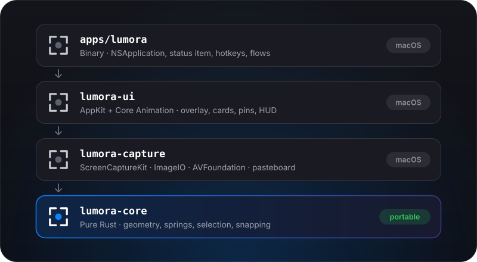

<p align="center">
  
</p>

<p align="center">
  <picture>
    <source media="(prefers-color-scheme: dark)" srcset="assets/readme/hero-dark.svg">
    <source media="(prefers-color-scheme: light)" srcset="assets/readme/hero-light.svg">
    
  </picture>
</p>

<p align="center">
  <b>截图与录屏，用起来就像 macOS 自带的一样。</b><br>
  一款原生菜单栏应用，用 Rust 构建于 AppKit、Core Animation 与 ScreenCaptureKit 之上。
</p>

<p align="center">
  <a href="https://github.com/lyinet/lumora/actions/workflows/ci.yml"></a>
  <a href="LICENSE"></a>
  
  
  
</p>

<p align="center">
  <a href="#功能">功能</a> ·
  <a href="#快捷键">快捷键</a> ·
  <a href="#安装">安装</a> ·
  <a href="#架构">架构</a> ·
  <a href="#路线图">路线图</a> ·
  <a href="README.md">English</a>
</p>

<br>

> [!NOTE]
> **Lumora 目前处于早期 alpha 阶段（v0.4）。** 整个应用已能针对 Apple Silicon 和 Intel 通过类型检查与 clippy，与平台无关的核心逻辑也有单元测试覆盖——但它**还没有在真机上运行过**，难免会有粗糙之处。下一个里程碑就是真机调试。⭐ **点个 Star 关注进展**；哪些已验证、哪些尚未验证，请看 [STATUS.md](STATUS.md)。

## 功能

<table>
  <tr>
    <td width="50%" valign="top">
      
      <h3>区域截图与窗口吸附</h3>
      <p>选区时屏幕画面会被冻结，视频和动画不会改变你截到的内容。背景变暗、选区清晰，实时显示 <code>W × H</code> 尺寸标签，像素放大镜会显示光标下的十六进制颜色。悬停即可高亮窗口，单击就能干净地截下它——连同阴影，即使它被其他窗口遮挡。拖动时，选区边缘会自动吸附到附近的窗口和显示器边缘。</p>
    </td>
    <td width="50%" valign="top">
      
      <h3>快速访问</h3>
      <p>每次截图都会落进一张玻璃卡片，借弹簧动画从左下角滑入。悬停可拷贝、保存、钉住或删除，也可以把卡片直接拖进 Slack、邮件或访达。最多叠放三张，平滑重排；不悬停时 6 秒后自动隐藏。</p>
    </td>
  </tr>
  <tr>
    <td width="50%" valign="top">
      
      <h3>钉在屏幕上</h3>
      <p>把任意截图悬浮在所有窗口之上作为参考。滚动缩放，<kbd>⌥</kbd> 加滚动调节透明度，拖动移动，双击或按 <kbd>Esc</kbd> 关闭。</p>
    </td>
    <td width="50%" valign="top">
      
      <h3>屏幕录制</h3>
      <p>录制选定区域或全屏，输出 H.264 或 HEVC 编码的 MP4，30 或 60 fps，可显示或隐藏光标，支持系统音频与麦克风（macOS 15+）。3-2-1 倒计时圆环、菜单栏里的红色计时器、悬浮的停止按钮，以及一圈绝不会出现在视频里的流动虚线边框。</p>
    </td>
  </tr>
</table>

**还有那些让它“感觉对了”的细节：**

- **Retina 精确输出** —— 按原生像素密度保存 PNG 并写入 DPI 元数据，在任何地方都以正确尺寸显示。文件名形如 `Lumora 2026-11-15 at 04.30.12.png`，并自动拷贝到剪贴板。
- **键盘级精度** —— 不碰鼠标也能移动选区、锁定比例、逐点微调（见下文）。
- **符合物理的动效** —— 每一次出现、吸附、微调和重排都是一个阻尼弹簧，被打断时会保留速度继续过渡。直接操作从不加动画，选区永远不会落后于你的指针。
- **先快门，再飞入** —— 选区闪一下白光，截图随即缩小飞向卡片，同时卡片滑入。
- **美化** —— 为截图加上渐变、纯色或图片背景，配合留白、圆角、柔和阴影、可选的 macOS 窗口边框和固定比例（16:9、1:1 等），在标注编辑器的 ✨ 面板中实时编辑。
- **可再编辑的 `.lumora` 文档** —— 每张保存的截图旁都会有一个 `.lumora` 文件，保存原始截图、标注和美化样式；在访达中双击（或用“打开…”），每个箭头、文字和裁剪都仍可编辑。
- **AI 写作（可选，默认关闭）** —— 在编辑器中点 ✨ 或按 <kbd>⌘</kbd><kbd>J</kbd>，即可生成配图说明、步骤指南、替代文本，或进行润色、翻译（English / 简体中文）、总结，结果流式显示，可一键插入为文字标注。服务商自选：OpenAI、DeepSeek、通义千问、Kimi（月之暗面）、本地 Ollama 或任意 OpenAI 兼容接口。API 密钥保存在 macOS 钥匙串中；默认只发送在本机识别出的文字和你的标注文字——只有在你主动开启后才会发送截图本身。
- **智能打码** —— 在编辑器中点一下（或按 <kbd>⌘</kbd><kbd>⇧</kbd><kbd>R</kbd>），即可对邮箱、手机号、身份证号与银行卡号（经校验位验证）、API 密钥与令牌、IP 地址、链接中的令牌以及人脸进行马赛克或模糊处理——全部用 Vision 在本机检测，并作为一次可撤销的操作添加。可在“设置 → 截图”中选择检测类别，也可开启“复制 / 保存新截图前自动打码”，或启用只发送识别文字、绝不发送图片的 AI 检查。
- **文字识别操作** —— “截取文字”（<kbd>⌥</kbd><kbd>⇧</kbd><kbd>2</kbd>）拷贝文字后，会弹出一个小浮动面板，提供拷贝、总结、翻译（English / 简体中文）、转为表格、转为代码和待办清单，结果流式显示在结果面板中，可拷贝、停止和重试。总结与翻译需要开启 AI 写作，其余功能无需 AI 即可使用。
- **截图转表格 / 代码** —— 在本机根据文字位置还原表格的行与列，可拷贝为 Markdown 或 CSV；也能把代码截图还原成代码并恢复缩进。开启 AI 写作后，AI 会在本地结果的基础上进一步优化；编辑器的 AI 菜单中也新增了“提取表格”和“提取代码”。

## 快捷键

使用 Option-Shift 组合，避免与 macOS 自带的 <kbd>⇧</kbd><kbd>⌘</kbd><kbd>3</kbd>/<kbd>4</kbd>/<kbd>5</kbd> 冲突。所有快捷键都可在 **设置 → 快捷键** 中重新绑定。

| 全局 | 快捷键 |
|---|---|
| 区域截图 | <kbd>⌥</kbd> <kbd>⇧</kbd> <kbd>4</kbd> |
| 全屏截图 | <kbd>⌥</kbd> <kbd>⇧</kbd> <kbd>3</kbd> |
| 窗口截图 | <kbd>⌥</kbd> <kbd>⇧</kbd> <kbd>5</kbd> |
| 录屏（开始 / 停止） | <kbd>⌥</kbd> <kbd>⇧</kbd> <kbd>R</kbd> |
| 打开截图文件夹 | <kbd>⌥</kbd> <kbd>⇧</kbd> <kbd>O</kbd> |

| 截图界面内 | 按键 |
|---|---|
| 拖动时移动整个选区 | <kbd>Space</kbd> |
| 锁定宽高比 | <kbd>⇧</kbd> |
| 微调 1 pt · 10 pt · 调整大小 | <kbd>←</kbd> <kbd>↑</kbd> <kbd>→</kbd> <kbd>↓</kbd> · 加 <kbd>⇧</kbd> · 加 <kbd>⌥</kbd> |
| 临时关闭边缘吸附 | 拖动时按住 <kbd>⌥</kbd> |
| 拷贝放大镜下的颜色（十六进制） | <kbd>C</kbd> |
| 确认（或双击） | <kbd>Enter</kbd> |
| 取消 | <kbd>Esc</kbd> |

## 为什么选择 Lumora

<table>
  <tr>
    <td width="50%" valign="top"><b>彻头彻尾的原生</b><br>Rust 通过类型化的 <code>objc2</code> 绑定直接调用 AppKit、Core Animation 和 ScreenCaptureKit。没有 WebView，没有 Electron，也无需附带运行时。</td>
    <td width="50%" valign="top"><b>闭式解的弹簧物理</b><br>动效来自 <code>lumora-core</code> 中的阻尼振子解析解，Core Animation 图层与窗口动画共用同一模型，稳定时间和过冲量都由单元测试约束。</td>
  </tr>
  <tr>
    <td width="50%" valign="top"><b>小巧的原生二进制</b><br>一款编译为单个原生可执行文件的菜单栏应用，发布版启用 thin LTO 并剥离符号。</td>
    <td width="50%" valign="top"><b>开源，MIT 许可</b><br>代码清晰、文档完善：严格的 crate 分层，每个 unsafe 代码块都有 <code>SAFETY:</code> 注释，设计令牌同步记录在 <a href="DESIGN.md">DESIGN.md</a> 中。</td>
  </tr>
</table>

## 安装

**Homebrew cask —— 即将推出。** 签名并公证的版本会在真机调试完成后发布（见[路线图](#路线图)）。在此之前，请从源码构建。

### 从源码构建

环境要求：macOS 14+、Xcode 命令行工具、Rust stable 1.80+。

```sh
git clone https://github.com/lyinet/lumora.git
cd lumora

# 在终端中运行调试版本
#（权限请求中显示的将是你的终端应用）
cargo run -p lumora

# 通用（arm64 + x86_64）应用包 + DMG，ad-hoc 签名
brew install create-dmg   # 可选；未安装时回退到 hdiutil
scripts/bundle.sh
open dist/Lumora.app

# 签名并公证的发布版本
SIGN_IDENTITY="Developer ID Application: Your Name (TEAMID)" \
NOTARY_PROFILE=lumora-notary scripts/bundle.sh
```

> [!TIP]
> “屏幕录制”权限与应用的代码签名绑定。ad-hoc 构建每次都会得到新的签名身份，所以每次重新构建后 macOS 都会再次请求授权——日常开发请使用固定的签名身份。

<details>
<summary><b>在 Linux 或 CI 中开发</b></summary>

<br>

纯逻辑的 crate 可以在任何平台上构建和测试：

```sh
cargo test -p lumora-core -p lumora-ui -p lumora-ai   # 几何、弹簧、选区、设置、快捷键、设计令牌
```

安装 Apple 目标后，可以在任何主机上对整个应用做类型检查：

```sh
rustup target add aarch64-apple-darwin x86_64-apple-darwin
cargo check --workspace --target aarch64-apple-darwin
cargo clippy --workspace --all-targets --target x86_64-apple-darwin -- -D warnings
```

</details>

<details>
<summary><b>设置与日志</b></summary>

<br>

设置以 TOML 格式保存在 `~/Library/Application Support/Lumora/settings.toml`。缺失的键使用默认值，未知的键会被忽略，损坏的文件会被移到 `settings.toml.bak`。日志输出到 stderr；设置 `LUMORA_LOG=debug` 可查看更多信息。

</details>

## 架构

<p align="center">
  
</p>

项目是一个由五个 crate 组成的 Cargo 工作区，依赖方向严格单向。不依赖操作系统的逻辑都放在最底层的 crate 中，在任何主机上都能测试；其上的每一层都是对 Apple 框架的一层轻薄、类型化的封装。

| Crate | 职责 |
|---|---|
| [`apps/lumora`](apps/lumora) | 可执行程序：`NSApplication`、状态栏图标、Carbon 全局快捷键、应用状态以及截图/录屏流程 |
| [`lumora-ui`](crates/lumora-ui) | AppKit + Core Animation：截图界面、快速访问、钉图、快门、倒计时、录屏控件、设置、引导、标注编辑器 + 美化面板 + AI 结果面板 |
| [`lumora-ai`](crates/lumora-ai) | AI 写作所用的 OpenAI 兼容流式客户端与钥匙串密钥存储 |
| [`lumora-capture`](crates/lumora-capture) | ScreenCaptureKit、ImageIO、AVFoundation、剪贴板、美化渲染 |
| [`lumora-core`](crates/lumora-core) | 纯 Rust：几何、弹簧、选区状态机、吸附、设置、文件名、快捷键解析、布局、录屏状态机、美化模型、`.lumora` 文档格式、AI 设置/提示词/流式解析 |

深入了解：[ARCHITECTURE.md](ARCHITECTURE.md)（线程模型、数据流、坐标空间）· [DESIGN.md](DESIGN.md)（颜色、形状、字体与动效令牌）。

## 路线图

以下内容均已编写完成、通过类型检查和单元测试，但**尚未在真机上运行**。

- [x] **v0.1 —— 截图与录屏：** 在冻结画面上的区域/窗口/全屏截图、快速访问、钉图、屏幕录制、设置、引导
- [x] **v0.2 —— 标注：** 标注编辑器、OCR（截取文字）、提示浮窗、简体中文本地化、应用图标、仅窗口模式、跨显示器选区
- [x] **v0.3 —— 美化：** 背景、留白、阴影、窗口边框、固定比例；可再编辑的 `.lumora` 文档
- [x] **v0.4 —— AI 写作：** 使用你自己的服务商生成说明、步骤指南、替代文本，以及润色、翻译、总结

**v0.5 —— 下一步**

- [x] 智能打码：在本机检测个人与敏感信息，一键马赛克 / 模糊，可选 AI 检查
- [ ] 在 Apple Silicon 与 Intel（macOS 14 和 15）上真机调试并修复问题
- [ ] 截图历史窗口（<kbd>⌥</kbd><kbd>⇧</kbd><kbd>H</kbd>）
- [ ] 录屏增强：点击涟漪、按键提示、macOS 14 麦克风、导出 GIF 与剪辑
- [ ] 滚动截图
- [x] 文字识别操作（总结、翻译、待办清单）与截图转表格 / 代码，本地优先

**以后**

- [ ] Developer ID 签名与公证、Sparkle 自动更新、Homebrew cask
- [ ] 编辑器打磨、录屏暂停/继续与摄像头气泡、云端链接、快捷指令自动化
- [ ] Mac App Store 版本、更多语言（日、繁中、德、法、西）

完整内容见 [ROADMAP.md](ROADMAP.md) 和 [CHANGELOG.md](CHANGELOG.md)。

## 参与贡献

非常欢迎贡献——而眼下最有价值的贡献，就是**在 Mac 上跑一跑 Lumora**。如果你试用了，请开一个 issue，写明芯片型号、macOS 版本，以及哪些正常、哪些出了问题。

- **较大的改动**请先开 issue 讨论。
- **保持 CI 通过：** `cargo fmt --all`、`cargo clippy --workspace --all-targets -- -D warnings`（在 Mac 上运行，或在其他平台加上 `--target aarch64-apple-darwin`），以及 `cargo test`（核心 crate 可在任何主机上运行）。
- **设计令牌存在于两处** —— `crates/lumora-ui/src/tokens.rs` 和 [DESIGN.md](DESIGN.md)，修改时请同步更新。
- **unsafe 代码**仅限于 FFI 调用，且每处都要有 `SAFETY:` 注释。

## 许可证

[MIT](LICENSE) © Lumora contributors

<br>

<p align="center">
  
  <br>
  <sub>用 Rust、AppKit 和许多弹簧打造。</sub>
</p>
